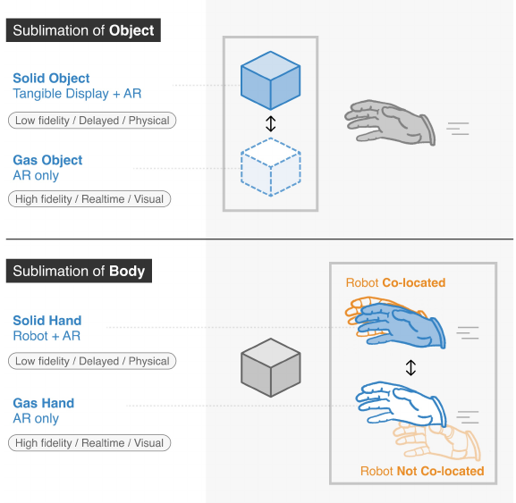
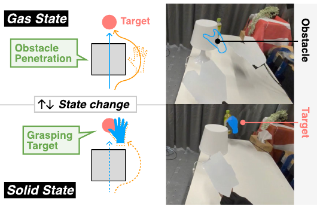
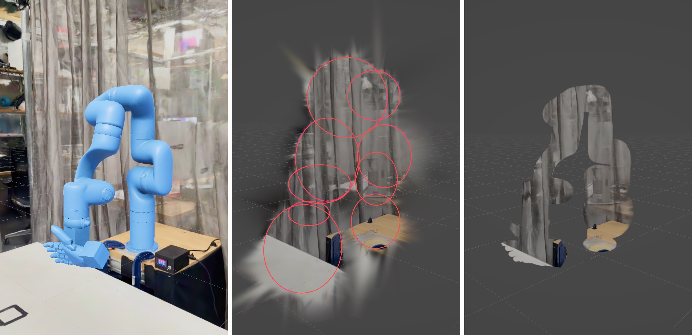
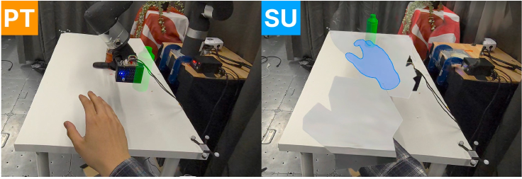
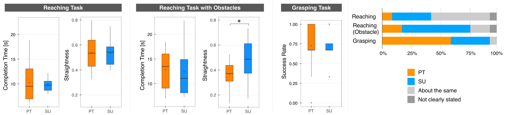

# Body Sublimation: Designing State-Changing Extended Hand for Embodied Out-of-Reach Interaction

## Abstract

Recent research in extended reality and robotics has explored ways to extend human reach beyond the physical body. XR supports embodied interaction at a distance but cannot manipulate the real world; robot-mediated systems provide physical capability but often disrupt embodiment through latency, workspace limits, kinematic mismatch, and collision avoidance.

Body Sublimation combines the perceptual flexibility of XR with a hidden robotic manipulator. A virtual hand becomes the user's extended body while both the original hand and robotic hand are visually removed using diminished reality. The extended hand changes between a free, virtual **gas state** and a physically grounded **solid state**, allowing users to reach through obstacles and manipulate real objects while maintaining a continuous sense of embodiment.

## Beyond Our Natural Reach

Our hands let us grasp and move the world around us, but only within the reach of our bodies. How can we interact with distant physical objects while still feeling that the hand doing the work is our own?

XR can extend a virtual hand with responsive, natural control, yet that hand cannot physically grasp an object. Robots can perform the grasp, but latency, limited workspace, and obstacle avoidance can make their movement differ from what we intend. Body Sublimation brings these capabilities together: one virtual hand provides the embodied experience, while a hidden robot provides physical interaction.

## What is Body "Sublimation"?

The name draws on the metaphor of a material changing between solid and gas. Inspired by **Sublimate** (Leithinger et al., CHI 2013), which switches objects between tangible and virtual representations, we apply this idea to **the body that performs the interaction**.

In the **solid state**, the hidden robot matches the virtual hand, grounding it physically so the user can grasp real objects. In the **gas state**, the hand is purely virtual and can move through obstacles or beyond the robot's workspace. When the robot catches up, the hand becomes solid again.

This sublimation of the body combines virtual freedom with physical capability. Diminished reality hides the original hand and robot, leaving the state-changing virtual hand as one continuous embodied representation.



## How the Extended Hand Works

### 1. A State-Changing Extended Hand

The user wears a Meta Quest 3 and controls a virtual hand through natural hand motion. A Go-Go-style mapping amplifies reach so the virtual hand can travel far beyond the biological arm.

#### Gas state

The outlined hand moves without physical constraints, passing through obstacles or beyond the robot's workspace.

#### Solid state

The filled blue hand is coupled with the robot and can grasp or move real-world objects.



### 2. A Robot Hidden with Diminished Reality



An xArm7 with a PSYONIC Ability Hand follows the virtual hand behind the scene. Gaussian splatting-based diminished reality removes both the robotic arm and the user's original hand from the passthrough view.

The robot autonomously handles collision avoidance, velocity limits, and workspace constraints. When it cannot match the virtual hand, the interface changes to the gas state instead of exposing the robot's mismatched motion.

## User Study

We compared Body Sublimation with a pass-through baseline in which the user's real hand and robot remained visible. Twelve participants completed reaching, obstacle-reaching, and grasping tasks. The robot and control pipeline were identical across conditions; only the visual representation changed.





Questionnaire results are shown below as **median (IQR)** on 7-point scales. PT = pass-through; SU = Body Sublimation. Asterisks mark differences between conditions: * p < .05; ** p < .01 (Wilcoxon signed-rank tests; no correction for multiple comparisons).

| Measure | Reaching PT | Reaching SU | Obstacle PT | Obstacle SU | Grasping PT | Grasping SU |
| --- | --- | --- | --- | --- | --- | --- |
| Ownership | 4.1 (1.4) | 5.4 (0.9)** | 4.3 (0.8) | 5.5 (0.9)* | 4.9 (1.7) | 5.5 (1.6)* |
| Agency | 5.1 (1.8) | 6.3 (1.0)* | 4.8 (1.8) | 6.0 (0.6)* | 5.8 (1.4) | 5.9 (1.1) |
| Change | 1.3 (0.6) | 1.8 (0.9)* | 1.3 (1.2) | 2.5 (1.9) | 1.3 (1.9) | 2.4 (1.7) |
| Pragmatic quality | 4.9 (0.6) | 5.9 (1.6)* | 5.3 (1.4) | 5.9 (0.6) | 6.0 (1.1) | 6.0 (1.9) |
| Hedonic quality | 5.5 (1.4) | 6.9 (0.6)** | 5.9 (1.4) | 6.6 (0.8)* | 6.1 (1.1) | 6.9 (0.3)** |

### 01 — Stronger embodiment

Ownership was significantly higher across all three tasks. Agency also increased in both reaching tasks.

### 02 — Maintained performance

Completion time and grasping success showed no significant differences from the visible-robot baseline.

### 03 — More efficient paths

With obstacles, Body Sublimation produced significantly straighter reaching trajectories (p = .04).

## Application Scenarios

### Fetching in Cluttered Spaces

Body Sublimation extends the user's reachable space through everyday obstacles. A user can retrieve a snack behind monitors and furniture without standing up or planning the robot's collision-free path themselves.


### Interaction Beyond Physical Barriers


The extended hand can transition to gas, cross a curtain or wall, and become physically grounded again on the other side. This preserves a continuous bodily trajectory instead of making the user switch to a separate robotic agent.

## Preview Video

https://www.youtube.com/watch?v=4zXc3zHhKUU&feature=youtu.be

## BibTeX

```bibtex
@inproceedings{ohta2026bodysublimation,
  title     = {Body Sublimation: Designing State-Changing Extended Hand for Embodied Out-of-Reach Interaction},
  author    = {Ohta, Masahiro and Ban, Reigo and Nii, Hideaki and Gourmelen, Guillaume and Narumi, Takuji and Sousa, Mauricio and Yoshida, Takatoshi and Minamizawa, Kouta},
  booktitle = {The 39th Annual ACM Symposium on User Interface Software and Technology},
  series    = {UIST '26},
  location  = {Detroit, MI, USA},
  publisher = {Association for Computing Machinery},
  address   = {New York, NY, USA},
  numpages  = {13},
  note      = {November 02--05, 2026},
  year      = {2026},
  doi       = {10.1145/3830398.3830583},
  url       = {https://doi.org/10.1145/3830398.3830583}
}
```
